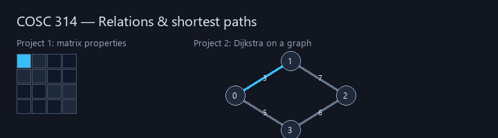
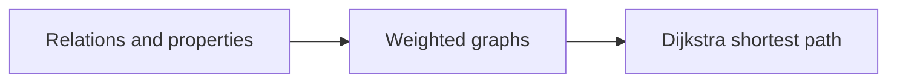

# COSC 314 - Computational Discrete Structures



College coursework portfolio for **COSC 314** at Eastern Michigan University.  
Java (BlueJ) projects on **relation properties** and **Dijkstra's algorithm**, plus archived homework PDFs.

**Author:** [Julio Barros](https://github.com/Jkbarros)  
**Index:** [college-projects](https://github.com/Jkbarros/college-projects)

## What is in this repository

| Area | Description |
|------|-------------|
| [Projects catalog](docs/projects-catalog.md) | Entry point for both Java projects |
| [Project 1 — Relations](docs/project-1-relations.md) | 10×10 matrix: reflexive, symmetric, etc. |
| [Project 2 — Dijkstra](docs/project-2-dijkstra.md) | Shortest paths from node 0 on a 9-vertex graph |
| [`sample-relation.txt`](Project%201/Project%201/sample-relation.txt) | Example input for Project 1 |
| [Course materials index](docs/course-materials-index.md) | Homework and class-note PDFs |
| [Repository guide](docs/repository-guide.md) | BlueJ and command-line run steps |
| [Archive index](docs/archive-index.md) | Full `archive/` file list |
| [`archive/course-materials/`](archive/course-materials/) | Original PDF exports from Canvas |

### Highlights

- Runnable `Relation.java` and `DijkstraExample.java` with BlueJ metadata
- Markdown walkthroughs with algorithm notes and code excerpts
- Animated README diagram (`scripts/generate_readme_demo.py`)

## Topics covered



## Run the Java projects

### BlueJ (course default)

1. Install [BlueJ](https://bluej.org/).
2. Open **`Project 1/Project 1`** or **`Project 2/Project 2`** (`package.bluej` included).
3. Run `Relation` or `DijkstraExample` from the class menu.

### Command line

**Project 1** (from `Project 1/Project 1`; enter `sample-relation.txt` at the prompt):

```bash
javac Relation.java && java Relation
```

**Project 2:**

```bash
javac DijkstraExample.java && java DijkstraExample
```

**Regenerate README GIF:**

```bash
pip install -r requirements.txt
python scripts/generate_readme_demo.py
```

## Related repos

| Course | Link |
|--------|------|
| COSC 111 - Programming & Data Structures | [programming-data-structures-cosc111](https://github.com/Jkbarros/programming-data-structures-cosc111) |
| COSC 381 - Software Engineering | [software-engineering-solutions](https://github.com/Jkbarros/software-engineering-solutions) |
| college-projects index | [college-projects](https://github.com/Jkbarros/college-projects) |

## Notes for readers

- `.class` files may be present from local runs; delete and recompile if needed.
- `__MACOSX` metadata from zip exports is ignored via `.gitignore`.

## License

Content © Julio Barros. Use at your own risk.
