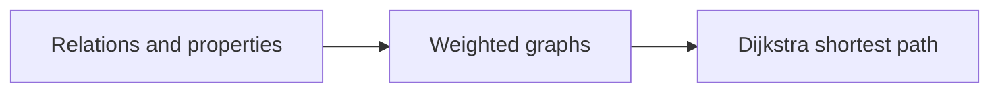

# COSC 314 - Computational Discrete Structures

College coursework portfolio for **COSC 314 - Computational Discrete Structures** at Eastern Michigan University.  
Java projects on **relations** (adjacency matrices) and **Dijkstra’s algorithm** for shortest paths.

**Author:** [Julio Barros](https://github.com/Jkbarros)  
**Index:** [college-projects](https://github.com/Jkbarros/college-projects)

## What is in this repository

| Area | Description |
|------|-------------|
| [Project 1 - `Relation.java`](Project%201/Project%201/Relation.java) | Read a relation matrix from file; test reflexive, anti-reflexive, symmetric, antisymmetric, transitive |
| [Project 2 - `DijkstraExample.java`](Project%202/Project%202/DijkstraExample.java) | Shortest paths from node 0 on a 9-vertex weighted graph |
| [Archive index](docs/archive-index.md) | Catalog of files in `archive/` with direct links |
| [`archive/course-materials/`](archive/course-materials/) | Homework PDFs and class notes from Canvas |

## Topics covered



## Run the Java projects

### Option A - BlueJ (course default)

1. Install [BlueJ](https://bluej.org/).
2. Open **`Project 1/Project 1`** or **`Project 2/Project 2`** as a BlueJ project (`package.bluej` is included).
3. Compile and run `Relation` or `DijkstraExample` from the BlueJ UI.

### Option B - Command line

**Project 1** (expects a matrix input file in the working directory - see `Relation.java`):

```bash
cd "Project 1/Project 1"
javac Relation.java
java Relation
```

**Project 2**:

```bash
cd "Project 2/Project 2"
javac DijkstraExample.java
java DijkstraExample
```

## Related repos

| Course | Link |
|--------|------|
| COSC 381 - Software Engineering | [software-engineering-solutions](https://github.com/Jkbarros/software-engineering-solutions) |
| IA 103 - Information Security | [information-security-overview](https://github.com/Jkbarros/information-security-overview) |

## Notes for readers

- `.class` files may be present from local runs; you can delete them and recompile.
- `__MACOSX` metadata from zip exports is ignored via `.gitignore`.

## License

Content © Julio Barros. Use at your own risk.
